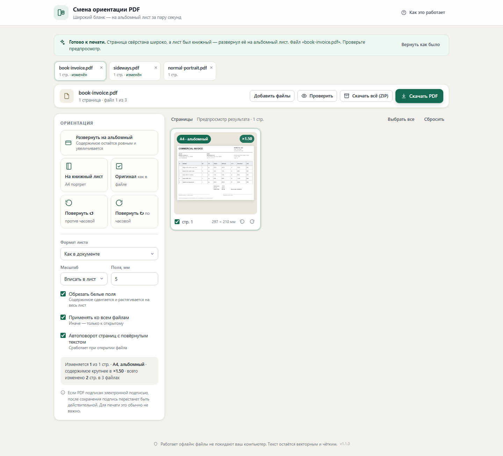
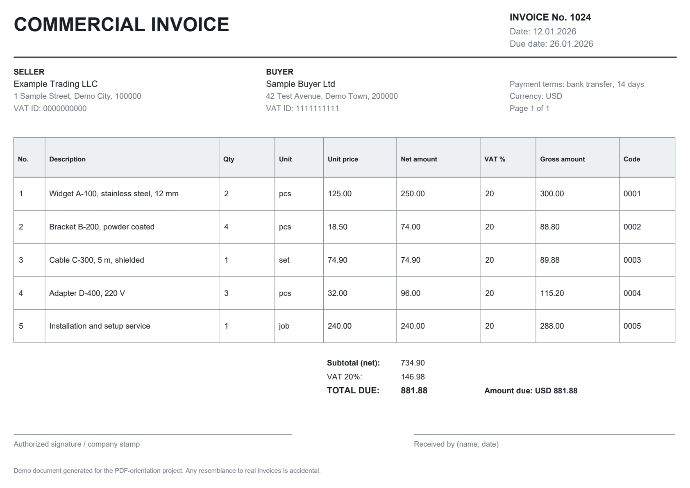

# Смена ориентации PDF

**Разворачивает книжный бланк на альбомный лист — за пару секунд, локально и без установки.**
Одностраничное приложение в одном HTML-файле: счета, акты, УПД, таблицы и другие широкие
бланки, которые пришли на книжном листе, превращаются в нормальный альбомный A4.

[](https://github.com/aleandr1tester/pdf-orientation/actions/workflows/ci.yml)
[](https://aleandr1tester.github.io/pdf-orientation/)



## Демо

Открыть без установки: **https://aleandr1tester.github.io/pdf-orientation/**

Страница полностью работает в браузере: файлы никуда не загружаются, интернет не нужен.

## Что делает

1. Вы перетаскиваете PDF.
2. Приложение находит границы содержимого каждой страницы (без белых полей).
3. Если бланк свёрстан широко, а лист книжный — предлагает альбомный A4, обрезает поля
   и увеличивает содержимое (обычно в 1,4–1,5 раза).
4. Проверяете предпросмотр — он показывает ровно то, что будет в файле, — и скачиваете PDF.

Текст остаётся текстом: он не превращается в картинку, остаётся выделяемым и ищется.
Результат выглядит как «родной» альбомный бланк:



## Возможности

**Автоматически при открытии файла**
* определяет широкое содержимое на книжной странице и разворачивает на альбомный лист;
* остальные страницы не трогает — они остаются как есть;
* многостраничные документы, у каждой страницы своё решение.

**Вручную (для выбранных страниц или всех)**
* **Развернуть на альбомный** / **На книжный лист** — переразмещение содержимого без поворота текста;
* **Повернуть ↺ / ↻** — поворот самой страницы (сканы, лежащие боком), лист меняет ориентацию;
* **Оригинал** — вернуть страницу как в исходном файле;
* формат листа: как в документе, A4, A5, A3, Letter;
* масштаб: вписать в лист, по ширине листа, 1:1;
* поля 0–40 мм, обрезка белых полей;
* выбор страниц и поворот отдельной страницы с карточки.

**Результат**
* «Проверить» — открывает готовый PDF в новой вкладке;
* «Скачать PDF» — сохраняет файл с понятным именем: `счёт (альбомный).pdf`;
* если ничего не меняли, скачивается исходный файл без изменений.

## Ограничения

* **PDF с паролем** не поддерживаются — снимите пароль в просмотрщике.
* **Электронная подпись** после изменения файла перестаёт быть действительной
  (визуальный штамп остаётся, для печати это обычно не важно).
* **Аннотации и штампы**: их рамки пересчитываются вместе со страницей, но при повороте
  на 90/180° внешний вид штампа может не повернуться. Встречается редко.
* Это **переразмещение содержимого**, а не пересборка вёрстки: текст не переносится заново.
  Для широких бланков, таблиц и счетов этого достаточно.
* Очень большие документы (сотни страниц) обрабатываются заметное время: каждая страница
  рендерится для предпросмотра.
* Проверялось в Chrome и Edge (движок Chromium). Firefox и Safari специально не тестировались.

## Быстрый старт

Просто откройте `index.html` двойным кликом — подойдёт Chrome, Edge или Яндекс.Браузер.

Чтобы получился сайт, достаточно выложить этот один файл на любой статический хостинг
(GitHub Pages уже настроен для этого репозитория).

Файл можно переименовать, например в `Смена ориентации PDF.html`, и положить куда удобно.

## Как это работает

1. **pdf.js** рисует страницу в скрытый холст и находит рамку непустого содержимого
   (отбрасывая белые поля). Рендер нужен только для анализа и предпросмотра.
2. Для каждой страницы считается матрица: масштаб + поворот + центрирование на новом листе.
3. **pdf-lib** пересобирает файл: содержимое страницы оборачивается в `q … cm … Q`,
   меняются `MediaBox`/`CropBox`, сбрасывается `/Rotate`. Векторы и шрифты не пересжимаются,
   поэтому качество не теряется, а размер файла почти не меняется.

Всё считается в браузере: ни один байт документа не покидает компьютер, сетевых запросов нет.

## Разработка

```
index.html              готовое приложение (единственный нужный файл, собирается из src/)
src/
  index.template.html   разметка
  style.css             стили
  app.js                интерфейс, pdf.js, сборка результата
  orient-core.js        геометрия: bbox -> матрица -> перезапись страниц
vendor/                 pdf-lib.min.js, pdf.min.js, pdf.worker.min.js (встроены в index.html)
build.js                сборка автономного index.html
dev/                    тесты, генератор демо-PDF, сквозной тест в браузере
docs/                   скриншоты для README
```

Сборка и тесты:

```bash
node build.js           # -> index.html (~1.9 МБ, всё внутри)
npm test                # геометрия, повороты, пустая страница, аннотации
```

Сквозной тест в настоящем браузере (Windows + Edge, через CDP):

```bash
node dev/test-browser.js dev/fixtures/book-invoice.pdf out.pdf screenshot.png
```

Тестовые PDF в `dev/fixtures/` синтетические (сгенерированы `node dev/make-demo.js`):
альбомный бланк, его «книжная» версия, многостраничный и повёрнутый документы.
Данные в них вымышленные.

CI настроен в `.github/workflows/ci.yml`: на каждый push собирает `index.html` и гоняет тесты.

## Лицензия

[MIT](LICENSE) © 2026 Ali (aleandr1tester)

Встроенные библиотеки:

* [pdf-lib](https://pdf-lib.js.org/) — MIT
* [PDF.js](https://mozilla.github.io/pdf.js/) — Apache-2.0
